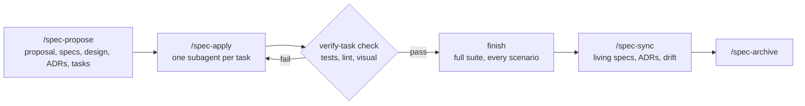

<p align="center"></p>

<h1 align="center">Wingman Spec</h1>

Wingman Spec is an [OpenSpec](https://github.com/Fission-AI/OpenSpec) schema, a set of workflow commands and a VS Code extension for spec-driven changes with AI agents in Claude Code, Cursor and Codex. You agree on testable requirements first. Then one fresh subagent builds each task test-first, and a deterministic verifier script accepts or rejects every step. Each requirement keeps its Why and links to the code and tests that implement it, so later edits that drift from the spec are reported.

## How it works



1. **Propose.** `/spec-propose <change>` writes the proposal, specs with scenarios, design, ADRs and a test-first task plan, then validates them.
2. **Apply.** `/spec-apply <change>` hands each task to a fresh subagent. `verify-task check` accepts a task only when its tests pass and only its box was ticked; UI tasks also get a browser check.
3. **Finish.** The verifier runs the full test suite and every declared scenario once more, and lists what blocks the archive.
4. **Archive.** `/spec-sync` merges the specs into the living specs and promotes the ADRs; `/spec-archive` refuses a change whose specs, ADRs or drift are open.

`@spec` markers in code and tests anchor each requirement. `verify-task drift` lists requirements without code or tests and code that changed without its requirement.

## Features

- Specs a junior developer can build from: every THEN names a value a test can check.
- One subagent per task, test-first, checked by a script instead of by the agent's own report.
- Fast by default. Each check runs only the task's targeted tests. Typecheck and lint run when a task group ends, the full suite at the review task and at finish.
- Visual check for UI work: the app is opened in headless Chromium, and accessibility, layout and console defects fail the task.
- ADRs for every significant decision, promoted to `adr/` on sync.
- Traceability: each requirement's Why, code and test anchors, and drift reports.
- A timeline of every build step and every plan change made during the build, with its reason.
- Starts from any point: `/spec-green-start` for a new product, `/spec-adopt` for an existing codebase. One workspace may hold 2 or more repos.
- VS Code and Cursor extension: dashboard, tasks, specs, ADRs, history, timeline, branch review and requirement traceability in the editor.

## Install

Requires Node 22 and the OpenSpec CLI (`npm install -g @fission-ai/openspec`).

```bash
./install.sh /path/to/project --harness all    # or --harness cursor, claude, codex
```

The extension: build `vscode-extension` (see [DEVELOPING.md](vscode-extension/DEVELOPING.md)) and install the `.vsix` with **Extensions: Install from VSIX...**.

## Quick start

In your agent:

```text
/spec-explore invoice export        # settle the open questions
/spec-propose add-invoice-export    # write and validate the plan
/spec-apply add-invoice-export      # build it task by task
/spec-archive add-invoice-export    # sync specs and ADRs, then archive
```

## Configuration

Settings live in `openspec/config.yaml`; the installer detects the test, typecheck, lint and app commands. `verify-task.cjs doctor` prints the effective values and where each came from.

## Documentation

- [Reference](docs/reference.md): artifacts, commands, configuration keys, visual check, design input, bundled skills.
- [Speed and defaults](docs/speed.md): what runs when and what each default costs.
- [Timeline](docs/timeline.md): the build log and plan changes.
- [Workspace layout](docs/workspace-layout.md): 2 or more repos in one workspace.
- [New product](docs/greenfield.md), [Fast path](docs/fast-path.md), [Test files](docs/test-files.md), [Parallel PRs](docs/parallel-prs.md), [Harness support](docs/harness-support.md).
- [VS Code extension](vscode-extension/README.md).
- [Changelog](CHANGELOG.md).


## License

MIT, see [LICENSE](LICENSE).
