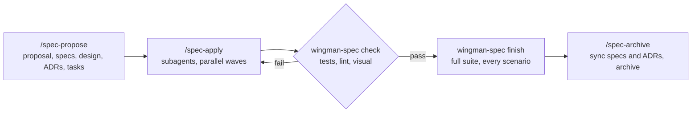

<p align="center"></p>

<h1 align="center">Wingman Spec</h1>

Wingman Spec is spec-driven development for AI coding agents in Claude Code, Cursor and Codex: one CLI (`wingman-spec`), a set of
`/spec-*` workflow commands and a VS Code extension. You agree on testable requirements first. Then fresh subagents build the tasks
test-first, and the CLI, not the agent, accepts or rejects every step. Each requirement keeps its Why and links to the code and tests
that implement it, so later edits that drift from the spec are reported.

## How it works



1. **Propose.** `/spec-propose <change>` writes the proposal, specs with scenarios, design, ADRs and a test-first task plan, then validates them.
2. **Apply.** `/spec-apply <change>` hands each task (or each group, or a wave of up to 3 independent tasks) to a fresh subagent. `wingman-spec check` accepts a task only when its tests pass and only its box changed; UI tasks also get a browser check.
3. **Finish.** `wingman-spec finish` runs the full test suite and every declared scenario once more, and lists what blocks the archive.
4. **Archive.** `/spec-archive` merges the delta specs into the living specs, promotes the ADRs (`wingman-spec sync`) and archives the change.

`@spec` markers in code and tests anchor each requirement. `wingman-spec drift` lists requirements without code or tests and code that changed without its requirement.

## Features

- Specs a junior developer can build from: every THEN names a value a test can check.
- One subagent per task, test-first, checked by the CLI instead of by the agent's own report. Tasks with separate files run in parallel waves.
- Fast by default. Each check runs only the task's targeted tests. Typecheck and lint run when a task group ends, the full suite at the review task and at finish.
- Visual check for UI work: the app is opened in headless Chromium, and accessibility, layout and console defects fail the task.
- ADRs for every significant decision, promoted to `adrs/` when the change is archived.
- Traceability: each requirement's Why, code and test anchors, and drift reports.
- A timeline of every build step and every plan change made during the build, with its reason.
- Starts from any point: `/spec-green-start` for a new product, `/spec-adopt` for an existing codebase. Specs can live next to the code or in their own repository shared by 2 or more code repositories.
- VS Code and Cursor extension: dashboard, tasks, specs, ADRs, history, timeline, branch review and requirement traceability in the editor. It bundles the CLI.

## Install

Install the **Wingman Spec** extension (`elmo-egers.wingman-spec`) from the VS Code Marketplace, or from Open VSX in Cursor.
It bundles the `wingman-spec` CLI for its platform and always uses that copy. Open the project and run **Wingman Spec: Set Up
This Folder**: it runs `wingman-spec init --harness all` with the bundled CLI.

`init` creates `.wingman-spec/` (settings, specs, changes, archive, ADRs), installs the `/spec-*` commands, subagents and bundled
skills for your agents, adds the workflow block to `AGENTS.md`, and writes the shim
`.wingman-spec/bin/wingman-spec`, which the agents call. The extension keeps that shim pointing at its bundled CLI, also after
an update, and offers `wingman-spec update` when the generated files are older than the CLI. Commit `.wingman-spec/` except the
gitignored `runs/`, `bin/`, `cache/` and `local/`. A project that used the OpenSpec-based 0.11 release converts once with
`wingman-spec import openspec`. See [docs/install.md](docs/install.md).

## Quick start

In your agent:

```text
/spec-explore invoice export        # settle the open questions
/spec-propose add-invoice-export    # write and validate the plan
/spec-apply add-invoice-export      # build it task by task
/spec-archive add-invoice-export    # sync specs and ADRs, then archive
```

## Configuration

Settings live in `.wingman-spec/wingman-spec.yaml`; `init` detects the test, typecheck, lint and app commands. Unknown keys are
errors. `wingman-spec config` prints the merged settings, `wingman-spec doctor` what is still missing, and
`wingman-spec help reference` every key, check and exit code.

## Documentation

- [Install](docs/install.md): the CLI, the extension, the shim, upgrades and the OpenSpec import.
- [Reference](docs/reference.md): artifacts, commands, configuration keys, visual check, design input, bundled skills.
- [Speed and defaults](docs/speed.md): what runs when and what each default costs.
- [Timeline](docs/timeline.md): the build log and plan changes.
- [Workspace layout](docs/workspace-layout.md): a specs repository shared by 2 or more code repositories.
- [New product](docs/greenfield.md), [Fast path](docs/fast-path.md), [Test files](docs/test-files.md), [Parallel PRs](docs/parallel-prs.md), [Harness support](docs/harness-support.md).
- [VS Code extension](vscode-extension/README.md).
- [Changelog](CHANGELOG.md).

## License

MIT, see [LICENSE](LICENSE).
